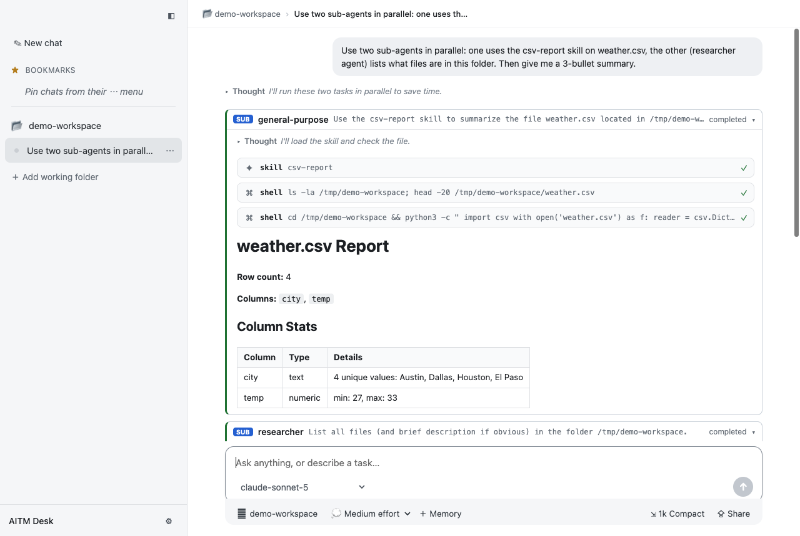

# AITM Desk

**A lightweight, Copilot-style desktop agent for _your own_ models.**

AITM Desk is a small macOS app that gives you a GitHub Copilot–like chat experience — a main agent that can call tools, load skills, and delegate to sub-agents — but pointed at **any OpenAI-compatible model endpoint** you control (a local proxy, vLLM, Ollama, LiteLLM, a cloud gateway, …). No repo, git or PR features: just a prompt box, an agent, and your working folder.

It reads skills and agents from the same places Copilot does — `<folder>/.github/` and `~/.copilot/` — so an existing skill/agent library works out of the box.



## Download

Grab the latest build from **[Releases](https://github.com/careychou/aitm-desk/releases)**:

| File | What |
|---|---|
| `aitm-desk-<version>-arm64.dmg` | Installer for Apple Silicon Macs (drag to Applications) |
| `aitm-desk-<version>-arm64.zip` | Same app, zipped |

> **The app is not code-signed.** macOS will say it "is damaged" or "can't be opened". After copying it to Applications, run once:
> ```bash
> xattr -cr "/Applications/AITM Desk.app"
> ```
> Or right-click the app → **Open**. Intel Macs: build from source (below).

On first launch open **⚙ Settings** and set your model endpoint's **Base URL** and **API key**, then click *Test connection*.

## Main features

### Agent
- **Model providers** — Settings → *Model providers* lists your providers, like Copilot's: any **OpenAI-compatible custom endpoint** (local model proxy, vLLM, OpenRouter, LiteLLM) and **Azure OpenAI** (resource host, API version, deployment names). Add several; the chat box groups models by provider and you switch models per chat. Keys are encrypted with the macOS Keychain.
- **Tools (Copilot-equivalent)** — `shell` (sync, or `async` for servers/watchers) with `read_shell` / `write_shell` / `stop_shell` / `list_shells`, `read_file`, `write_file`, `edit_file`, `glob`, `grep`, `web_fetch` (page → Markdown), `sql` (a per-chat SQLite scratch DB with a ready `todos` table for planning), `skill`, `task`, `read_agent`, `list_agents`, `ask_user`. Independent tool calls run in parallel. Copilot names (`view`, `create`, `bash`, `web`…) work in agent `tools:` lists.
- **Interactive / Autopilot** — per chat, next to the folder below the chat box. **Autopilot** (the default) runs shell, file and web tools without asking; **Interactive** asks first (*allow once*, *allow for this chat*, or *deny*). Switching to Autopilot approves anything the chat is waiting on. Set the default for new chats in Settings.
- **Copilot-style activity** — each tool call shows a plain description ("Install dependencies", "Edit src/app.ts", "Fetch docs.python.org/…") instead of the tool name; consecutive calls fold into one row ("Run tests and 3 other tool calls"). Expand to see each call, and expand a call to see the `$ command` and its output in a terminal block, file diffs, or SQL results.
- **Sub-agents** — the `task` tool runs a sub-agent with fresh context. Several `task` calls in one turn run **in parallel**; `mode: "background"` returns immediately and the result is fetched later with `read_agent` (the main agent is woken when it finishes). Nested delegation is capped at depth 2; Stop cancels the whole tree.
- **Model thinking** — a Copilot-style *Thinking → Thought* block streams the model's reasoning and collapses to a one-line peek. Per-chat effort: 💭 off / low / medium / high. Reads `reasoning_content` / `reasoning`, inline `<think>` tags, and Gemini thought parts.
- **Queue follow-ups while it works** — keep typing while the agent runs, the way Copilot does. A queued prompt shows above the box (× to pull it back) and joins **the same conversation** at the agent's next step, after the current tool results and before its next model call, so the agent changes course mid-task. No second agent is started. If the agent has already answered, the queued prompt starts the next turn. *Stop* cancels the run, including any pending approval, and puts queued text back in the box.

### Skills & agents (Copilot-compatible)
- **Skills**: `skills/<name>/SKILL.md` with YAML front-matter (`name`, `description`). Only names + descriptions go into the prompt; the model loads a skill's full body on demand with the `skill` tool.
- **Agents**: `agents/<name>.agent.md` (`name`, `description`, `tools`). The body becomes the sub-agent's system prompt and `tools:` its whitelist (aliases like `read`, `search`, `edit`, `execute`, `agent` are understood).
- Loaded from the chat's working folder (`.github/`) **plus** your personal `~/.copilot/`; also picks up `copilot-instructions.md` from both.

### Chats & organization
- **Working folders** — the sidebar groups chats by folder, Copilot-style. Pick the folder when starting a chat; skills/agents reload per folder.
- **Fork from any turn** — hover a turn → *⑂ Fork from here*. The fork gets the history up to that point and is filed **under the chat it came from** (forks of forks nest).
- **Drag & drop** — drag chats to reorder them (within the same folder/level), drag a chat onto **Bookmarks** or a bookmark folder to pin it, and drag pins/folders to reorder or nest them.
- **Rename & delete** — double-click to rename, or use the ⋯ menu / right-click.
- **Bookmarks** — a pinned section at the top of the sidebar with nestable folders.
- **Resizable sidebar** — drag its edge to resize (double-click resets), drag it past the minimum width or press **⌘B** to hide it, and use ◧ or ⌘B to show it again. The width and the hidden/shown state are remembered.

### Attachments
- **Paste, drop or 📎** — paste screenshots/files (⌘V), drag files anywhere onto the window, or pick them with 📎. Chips show the size before → after and estimated tokens.
- **Images** (PNG, JPEG, GIF, WebP, HEIC, TIFF, BMP): downscaled to a max edge (default 1568 px) and re-encoded (JPEG q82, stepping down until ≤ 1.5 MB). They are sent as `image_url` parts and look the same to the model at a fraction of the size.
- **Documents**: PDF (text per page; scanned PDFs fall back to a page image), Word/RTF/ODT/HTML (via macOS `textutil`), PowerPoint (slide text), Excel (sheet rows), and any plain-text or code file. Text is whitespace-normalized and long files are trimmed head + tail (default 80k chars).
- **Request-size guard**: images are re-sent only for the last N prompts (default 4; older ones become a note), and the oldest images are dropped if a request would exceed the cap (default 20 MB, safely under Vertex's 30 MB). All limits are in Settings → *Attachments*.

### Memory & context
- **Share a session** — export **all turns or selected turns** to Markdown (optionally with tool calls and thinking), save to a file or copy to clipboard.
- **Attach exports as memory** — *＋ Memory* attaches one or more exported `.md` files to a chat; the agent starts with them as prior context. Great for handing work between sessions or people.
- **Smart compaction**: *⇲ Compact* (which also shows the estimated context size) has two modes. **Keep the last N turns** word-for-word and summarize everything before them, or **Choose turns** and set each turn to **Keep · Summarize · Drop**. You can set a turn singly, or set a whole **related-topic cluster** at once (clusters can be non-adjacent when a long chat pivoted and came back). Kept turns can be anywhere in the chat, so an important early instruction stays verbatim. Forks made after a compaction still line up with the right turns. Settings → *Memory compaction* picks a separate (cheaper) **compaction model** and a **cache-aware auto-compact** policy: it waits until the chat has been idle long enough for the provider's prompt cache to expire, unless the chat is very large, and skips small gains (see [doc/memory-compaction.md](doc/memory-compaction.md#91-compaction-and-the-prompt-cache-why-auto-waits)).

### AI usage
- **AI usage panel (⌘⇧U)**: the ring button in the sidebar footer, next to ⚙, opens it. The ring fills against an optional **daily budget** and turns amber at 80% and red at 100%; it shows today's estimated spend.
- **This app**: every model call this app makes, from the main agent and sub-agents, is recorded locally in `aitm.db` as it happens. Each record holds input, cached, cache-write and output tokens. The panel shows totals, cache-hit rate, a per-day chart, and breakdowns **by model** and **by chat** (click a chat to open it). Ranges: today, 7 days or 30 days.
- **Cost estimate**: list prices come from a `pricing.json` (USD per 1M tokens, per model, with dated price changes). It is looked up in Settings, then `~/.aitm-desk/pricing.json`, then `~/heb-model-proxy/pricing.json`. Without one, the panel shows tokens only.
- **Project tab (optional)**: shows usage for the whole project, covering every caller and not just this app, by running a command that follows the `--days N --by model,day --json` contract (e.g. a Cloud Monitoring cost script). Set the command in Settings → *AI usage*.

### Under the hood
- Electron + React UI over a **headless TypeScript engine** (also usable from a CLI).
- Sessions, forks and bookmarks are stored locally in SQLite (`node:sqlite`) at `~/.aitm-desk/aitm.db`, with settings in `~/.aitm-desk/settings.json`. Set `AITM_HOME` to use another folder. Provider API keys are encrypted with the macOS Keychain (`safeStorage`). Builds before 0.3 kept these files in `~/Library/Application Support/aitm-desk/`; they are copied over on first launch and the originals are left in place as a backup.
- No telemetry. The only network calls go to the model endpoint you configure (plus the optional project-usage command, if you set one).

## Model endpoint notes

Any endpoint that speaks the OpenAI Chat Completions API with streaming + tools works. For the usage panel, the endpoint should honor `stream_options.include_usage` (a final chunk with `usage`, optionally with `prompt_tokens_details.cached_tokens`). Defaults: `http://127.0.0.1:4141/v1` (override in Settings or with `AITM_BASE_URL` / `AITM_API_KEY`).

**Azure OpenAI:** add it under Settings → *Model providers* with the resource host (`https://<resource>.openai.azure.com`), an API key, the API version (default `2025-04-01-preview`) and one deployment name per line. Each deployment appears as a model (`<provider-id>::<deployment>` when Azure is not the primary provider).

For thinking blocks the app sends `reasoning_effort` and a non-standard `include_reasoning: true` hint. Models that already stream `reasoning_content` (DeepSeek, GLM, gpt-oss, Qwen…) just work. For Anthropic Claude behind an OpenAI-style proxy, the proxy must enable Claude's (adaptive, summarized) extended thinking and map it to `reasoning_content`.

## Technical documentation

See [`doc/`](doc/README.md) for how it works inside: [agent framework](doc/agent-framework.md) (loop, sub-agents, queue, tools), [memory compaction](doc/memory-compaction.md), and [other algorithms and internals](doc/algorithms-and-internals.md).

## Build from source

Requires Node 22.5+ (for `node:sqlite`) — tested with Node 25.

```bash
git clone https://github.com/careychou/aitm-desk.git
cd aitm-desk
npm install
npm run dev            # hot-reload dev mode
npm test               # vitest: engine, tools, registry, adapter, compaction, export
npm run dist           # → dist/AITM Desk-<version>-arm64.dmg / .zip
npm run dist:dir       # → dist/mac-arm64/AITM Desk.app (fast, unpacked)
```

### Headless CLI (same engine)
```bash
npm run cli -- --models
npm run cli -- --cwd ~/my-project --model my-model -p "list the skills you have"
npm run cli -- --yes -p "..."   # auto-approve shell and file writes
```

## Project layout
```
src/engine/    headless agent engine: adapter, registry, tools, loop, sub-agent manager, session, compaction
src/cli/       terminal runner
src/main/      Electron main: settings (safeStorage), SQLite store, IPC
src/preload/   contextBridge API
src/renderer/  React UI
src/shared/    fork/tree, export and usage/pricing helpers shared by main + renderer
doc/           technical docs (agent framework, memory compaction, algorithms), history/ (original MVP spec + plan), images/
```

## Status

Early, personal project (v0.1). macOS / Apple Silicon is the only packaged target. Issues and PRs welcome.

## License

[MIT](LICENSE)
