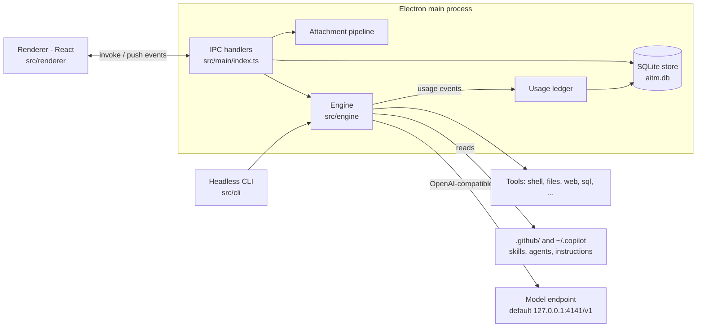

# Technical documentation

How AITM Desk works inside. Start here, then read the deep dives.

| Doc | What it covers |
|---|---|
| [agent-framework.md](agent-framework.md) | Agent loop, sub-agents, context passing, request queue, tool calls, permissions, cancellation, system prompt, event model |
| [memory-compaction.md](memory-compaction.md) | How long chats are compacted: turns, plans, clustering, summarization, incremental merge, turn map, compaction model, cache-aware auto-compact |
| [algorithms-and-internals.md](algorithms-and-internals.md) | Model providers and routing (custom endpoint, Azure OpenAI, native Google Vertex AI with service-account auth), adapter and streaming, attachment compression and request budget, persistence and forks, ordering, memory export, usage and cost, shell/sql/web_fetch tools, settings |

> [`history/design.md`](history/design.md) and [`history/plan.md`](history/plan.md) are the original MVP spec and plan. They are historical: compaction, attachments, queueing, usage and modes were added later and are documented here.

## Architecture at a glance



Key design decisions:

- **The engine is headless.** `src/engine` has no Electron imports. The desktop app and the CLI both drive it through the same `Session` class and a `Hooks` object (events out, permission/ask questions in). This is why it can be tested without a UI.
- **One conversation per chat, one `Session` object per open chat.** The main agent's message history is a plain OpenAI-style `messages[]` array. Everything else (UI items, sub-agent transcripts) is derived from engine events.
- **Sub-agents are just nested loops** with fresh context; they share the model concurrency limit, the permission gate and the shell manager.
- **The UI is an event fold.** The renderer never asks the engine "what happened"; it folds a stream of `AgentEvent`s into an item tree (`src/renderer/src/state.ts`).
- **Pure functions for the hard parts.** Compaction planning, fork slicing, ordering, attachment sizing and pricing are pure and unit-tested (`tests/`).

## Source map

| Path | Role |
|---|---|
| `src/engine/loop.ts` | One agent's turn loop (model call → tool calls → repeat) |
| `src/engine/engine.ts` | `Session`: history, queue, busy state, compaction entry points |
| `src/engine/manager.ts` | `AgentManager`: agent tree, sync/background sub-agents, notifications |
| `src/engine/prompt.ts`, `registry/` | System prompt, skills, agents, instructions discovery |
| `src/engine/permissions.ts`, `semaphore.ts` | Approval gate, model-call concurrency |
| `src/engine/compact.ts` | Compaction algorithms |
| `src/engine/content.ts` | User content with attachments, request budget (`fitRequest`) |
| `src/engine/adapter/` | OpenAI-compatible streaming client and delta assembler |
| `src/engine/tools/` | Tool implementations and the tool catalog |
| `src/main/` | Electron main: IPC, SQLite store, attachments, settings, usage, data home |
| `src/shared/` | Pure helpers shared by main and renderer (fork, attach, usage, export) |
| `src/renderer/src/` | React UI and the event-to-item fold |

## Data home

Everything lives in `~/.aitm-desk` (override with `AITM_HOME`):

```
~/.aitm-desk/
  aitm.db                  chats, messages, UI items, folders, bookmarks, usage ledger
  settings.json            settings; provider API keys are stored encrypted (providers[].apiKeyEnc, Electron safeStorage)
  pricing.json             optional price table for the usage panel
  sessions/<chat-id>/session.db   the per-chat scratch SQL database used by the `sql` tool
```

Exports ("shares") go to `~/Documents/<app name>/shares` so users can find them. On first launch after the move from the old Electron userData folder, `migrateDataHome` copies the database with `VACUUM INTO` (a consistent snapshot even if the source is in WAL mode).
