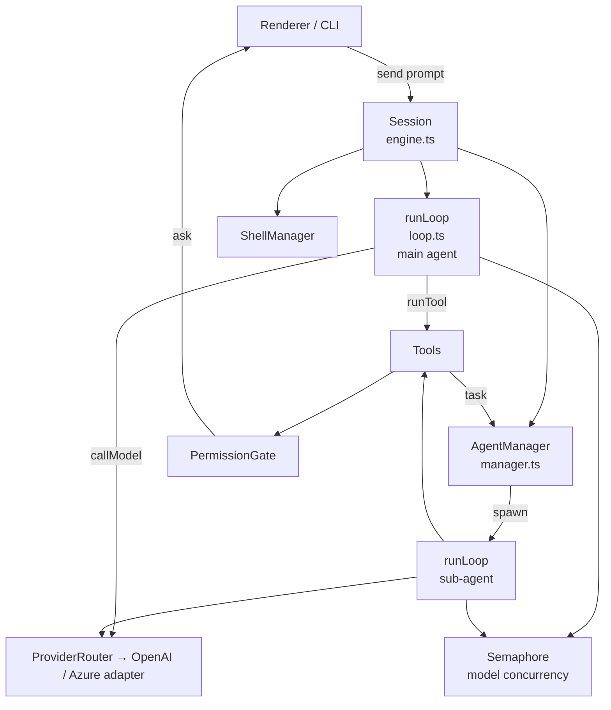
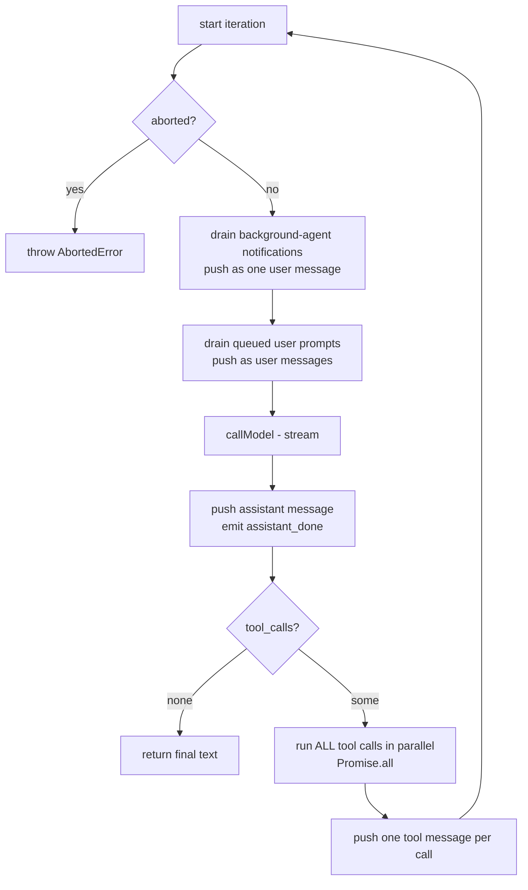
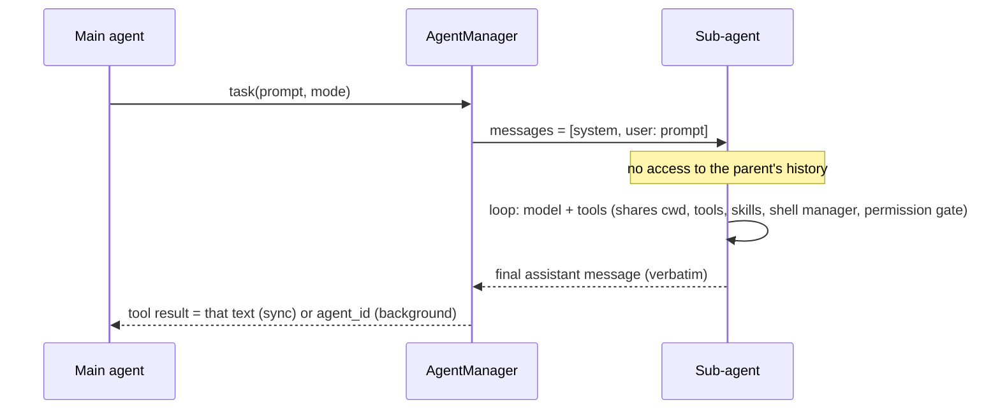
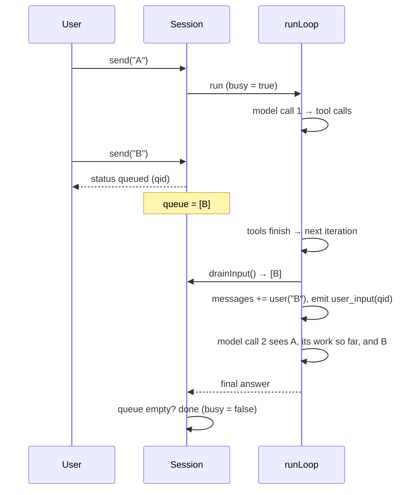

# Agent framework

This document explains how a prompt becomes a sequence of model calls and tool calls, how sub-agents work, how follow-up prompts are queued, and how approvals and cancellation behave. Source files are named so you can follow along.

## 1. Components



| Class | Responsibility |
|---|---|
| `Session` | Owns one chat: the `messages[]` history (`[system, ...history]`), the busy flag, the prompt queue, the `AgentManager`, the `ShellManager`. Entry point for `send`, `stop`, `compact`. |
| `runLoop` | One agent's loop. Used for both the main agent and every sub-agent. |
| `AgentManager` | Tracks the agent tree, spawns sub-agents (sync or background), holds background results and notifications, cascades cancellation. |
| `PermissionGate` | Decides whether a tool call may run (autopilot, remembered approvals, or ask the user). |
| `Semaphore` | Caps simultaneous model requests per chat. |
| `ProviderRouter` / `OpenAIAdapter` | Picks the provider that owns the model id, then streams one chat completion (OpenAI-compatible or Azure OpenAI) as deltas. |

## 2. The agent loop

`runLoop(opts, messages)` runs until the model answers without asking for tools, or until `maxTurns` is reached (settings: `maxTurnsMain` = 50, `maxTurnsSub` = 30).



Details that matter:

- **Everything is one `messages[]` array** in OpenAI format: `system`, `user`, `assistant` (with optional `tool_calls`), `tool` (with `tool_call_id`). The loop mutates it in place and the `Session` persists it.
- **Tool calls in one assistant message run in parallel.** The model gets all results back in the next request, in call order. This is also how parallel sub-agents happen (several `task` calls in one response).
- **Notifications and queued prompts are injected at the top of an iteration**, i.e. after the previous tool results and before the next model call. See §5 and §4.4.
- **`callModel`** takes a `Semaphore` slot only around the streaming request, never while tools run. This means a parent that is waiting on a sub-agent does not hold a slot, so nested agents cannot deadlock the pool.
  - Deltas are merged by the `Assembler`: text and reasoning are concatenated, tool-call fragments are merged by `index`. If the provider omits tool-call ids, ids are generated.
  - It emits `text`, `reasoning` and `usage` events as they arrive.
  - **Retry:** one retry after 1.5 s on HTTP 5xx, 429 or a network error, but only if nothing has been streamed yet (so the UI never shows duplicated text). Abort raises `AbortedError`, which is never retried.
- **Max turns** ends the run with an error (`stopped after reaching the max of N turns`) rather than looping forever.

### Events

The loop and tools emit `AgentEvent`s through `Hooks.onEvent`. Every event carries an `agentId` (`main` or the sub-agent id). The main kinds:

| Event | Meaning |
|---|---|
| `text`, `reasoning` | Streaming deltas for the assistant message / thinking block |
| `assistant_done` | One assistant message is complete |
| `tool_start`, `tool_end` | A tool call began / finished (with a human-readable summary and the output) |
| `agent_start`, `agent_end` | A sub-agent was spawned / finished |
| `user_input` (`qid`) | A queued prompt has just been injected into the conversation |
| `queue_cleared` (`qids`) | Queued prompts were discarded (error or cancel) |
| `usage` | Token counts for one model request (model, prompt, completion, cached, cacheWrite) |
| `error` | Run failed |

The renderer folds these into a tree (§9).

## 3. Tool calls

### 3.1 Execution (`runTool`)

1. Emit `tool_start`.
2. Parse the JSON arguments. **A parse error is returned to the model as the tool output** (`Error: …`) so it can correct itself instead of the run failing.
3. If the tool declares a `permission` kind, ask the `PermissionGate` (see §6). A denial is also returned as the tool output.
4. Run the tool. **Exceptions become `Error: <message>` output**, again so the model can recover.
5. Emit `tool_end`, push the `tool` message.

Tool failures therefore never abort the loop. Only abort/cancel and model-request failures do.

### 3.2 Catalog

| Tool | Permission | Notes |
|---|---|---|
| `shell` | shell | `zsh -lc`, sync (timeout default 120 s, max 600 s, output tail 30,000 chars) or `mode: async` returning a `shellId` |
| `read_shell`, `write_shell`, `stop_shell`, `list_shells` | write_shell: shell | Interact with async shells |
| `read_file` | – | Optional 1-based line range; output capped at 50 KB; directories list entries |
| `write_file` | write | Creates parent folders |
| `edit_file` | write | Replaces exactly one occurrence; fails if `old_str` is missing or not unique (the error asks for more context) |
| `glob` | – | `**`, `*`, `?`, `{a,b}`; up to 200 results; walk limit 20,000 files |
| `grep` | – | ripgrep if installed, else a JS fallback; up to 200 matches |
| `web_fetch` | url | HTML → Markdown, 30 s timeout, `max_length` default 5,000 (max 20,000), paging with `start_index` |
| `sql` | – | Per-chat SQLite scratch DB with `todos` and `todo_deps` tables |
| `skill` | – | Loads a skill's full `SKILL.md` body on demand |
| `ask_user` | – | Blocks until the user answers in the UI (optional choices) |
| `task`, `read_agent`, `list_agents` | – | Sub-agent tools (§4) |

### 3.3 Tool selection per agent

`selectTools(agentTools, depth)` decides what an agent sees:

- No `tools:` list, or `'*'` → all tools.
- Otherwise the baseline (`skill`, `ask_user`) plus the listed tools, with **aliases** expanded the way Copilot agent files use them:
  `read` → read_file/glob/grep, `view`, `search`, `edit`, `create`, `write`, `execute`/`shell`/`bash` → shell family, `web`/`fetch` → web_fetch, `sql`/`todo` → sql, `agent`/`task` → task family.
- At depth ≥ 2 (`MAX_DEPTH`), `task`, `read_agent` and `list_agents` are removed so agents cannot recurse indefinitely.

This keeps custom `.agent.md` files written for GitHub Copilot working unchanged.

## 4. Sub-agents

### 4.1 Spawning

The main agent calls the `task` tool:

```jsonc
{ "prompt": "complete, standalone task description",
  "agent": "optional name from the agents list (default: general-purpose)",
  "description": "3-5 word UI label",
  "mode": "sync" | "background" }
```

`AgentManager.spawn()` then:

1. Registers an entry (info, AbortController, `done` promise, `notifications[]`, `children`) in the agent tree. Ids look like `<name>-<counter><rand>`.
2. Builds a **fresh message list**: `[system, user(prompt)]`. The system prompt is `buildSubSystem` (§7).
3. Runs `runLoop` with the sub-agent's tool set and `maxTurnsSub`.
4. Emits `agent_start` / `agent_end`; events from the child carry the child's `agentId`, so the UI nests them under the parent's `task` item.

### 4.2 Context passing



- **Down (parent → child): only the `prompt` string.** The child does not see the parent's conversation, memories, or earlier tool results. The parent is therefore expected to put everything the child needs into the prompt (file paths, constraints, what to return). The sub-agent's own rules say "You start with no prior conversation; the task prompt is all the context you get."
- **Up (child → parent): only the child's final assistant message**, returned verbatim as the `task` tool result (sync) or via `read_agent` (background). The child's intermediate tool calls and thoughts are visible in the UI but are not added to the parent's context, which keeps the parent's window small.
- **Shared, by reference, across the whole tree:** the registry (skills, agents, instructions), working folder, `ShellManager` (a shell started by one agent can be read by another if the id is known), `PermissionGate` (approval "for the session" applies to everyone), `Semaphore`, and the per-chat `sql` database.

### 4.3 Sync, background and parallel

| Mode | Behavior |
|---|---|
| `sync` (default) | The `task` call blocks until the child finishes; the result is the child's final text. |
| `background` | `task` returns an `agent_id` immediately. The parent keeps working. On completion the child's result is stored and a **notification** is queued for the parent (see §5). The parent fetches the answer with `read_agent(agent_id, wait?, timeout?)` (default wait 60 s, max 600 s). |
| parallel | Not a mode: several `task` calls in one assistant message are executed by the loop's `Promise.all`, so the children run concurrently (bounded by the semaphore). |

`list_agents` returns the agents of the current session with status (`running`, `completed`, `failed`, `cancelled`).

### 4.4 Depth and limits

`MAX_DEPTH = 2`: main (depth 0) → sub-agent (1) → sub-sub-agent (2). At depth 2 the delegation tools are not offered. Concurrency is capped by `maxConcurrency` (default 4) simultaneous model requests across the entire tree.

### 4.5 Cancellation

- **Stop** (UI button / `Session.stop`) aborts the main controller and calls `AgentManager.cancelAll()`, which aborts every running agent, including background ones.
- A parent's abort signal also aborts its children through a listener, so the cascade works even for sync children.
- Running tools see the signal; `shell` kills the whole process group (SIGTERM, then SIGKILL after 3 s).
- After a cancel or failure `repairHistory` appends `Error: cancelled` tool results for any assistant `tool_calls` that never got an answer. Without this the next request would be rejected by the provider because OpenAI-format histories must answer every tool call.

## 5. Background completion and notifications

When a background agent finishes:

1. Its entry is marked complete and a notification is pushed onto the **parent's** `notifications[]`.
2. `onBackgroundDone` fires.
3. If the parent loop is running, `drainNotifications()` injects it at the next iteration as a single user message:

```
<system_notification>Background agent research-1-3k2 (research-1) completed. Use read_agent with agent_id "research-1-3k2" to get its result.</system_notification>
```

The status word is whatever the child ended as: `completed`, `failed` or `cancelled`.

4. If the whole session is **idle** (the main agent has already answered), `Session`'s idle hook starts a run with no new prompt; the loop's drain then delivers the notification and the main agent wakes up, reads the result and continues, as Copilot does.

`<system_notification>` messages are *not* "real user" messages: compaction does not treat them as turn starts (see memory-compaction.md).

## 6. Permissions and modes

Tools with a `permission` kind are gated: **shell** (`shell`, `write_shell`), **write** (`write_file`, `edit_file`), **url** (`web_fetch`).

| Mode | Behavior |
|---|---|
| **Autopilot** (default; `defaultMode` setting) | `setAutoApprove(true)`: every gated call is approved without asking. |
| **Interactive** | The gate emits a permission request to the UI with a plain-language description. The user picks Allow, "Allow all <kind> this session" (remembered per kind), or Deny. A denial is returned to the model as tool output. |

The mode is stored per chat and can be changed mid-run; the gate reads it per request. Read-only tools (`read_file`, `glob`, `grep`, `sql`, `skill`) are never gated. Requests from sub-agents come through the same gate and show which agent asked.

> Autopilot is not a sandbox. Shell commands run as the user. Use Interactive when working with an untrusted prompt or folder.

## 7. System prompt construction (`prompt.ts`, `registry/`)

**Main agent system prompt** is assembled from:

1. Base rules: identity (the brand title), act with tools rather than describe, load a skill before doing work it covers, delegate with `task` (several calls in one response run in parallel; `background` for long work), make independent tool calls in parallel, give every shell call a short `description`, use async shells for servers, track plans in the `sql` todos table, say one sentence before a batch of tool calls, never print secrets.
2. Environment: working folder, OS, today's date.
3. Instructions: `~/.copilot/copilot-instructions.md` then `<cwd>/.github/copilot-instructions.md`.
4. **Skills list**: `name: description` only (description clipped to 250 chars).
5. **Agents list**: `name: description` (clipped to 200 chars).
6. **Attached memories** (§ memory export), capped at 60,000 chars, each wrapped in `<memory>` tags and labelled as background context, not instructions.

**Sub-agent system prompt** (`buildSubSystem`): the agent's role (the `.agent.md` body, or a general-purpose role), sub-agent rules (start with no prior conversation; work autonomously; the FINAL message is returned verbatim to the caller, so make it a complete, self-contained answer), environment, instructions, skills list; the agents list is included only if the sub-agent may delegate.

### Skill and agent discovery

- Roots, in priority order: `<cwd>/.github` (project), then `~/.copilot` (personal). **First name wins**, so a project skill overrides a personal one with the same name.
- Skills: `skills/<dir>/SKILL.md` with YAML front-matter (`name`, `description`).
- Agents: `agents/*.agent.md` with front-matter (`name`, `description`, `tools`); the body becomes the sub-agent's system prompt.
- Malformed front-matter is skipped and reported as a warning; it never blocks startup.
- The registry is loaded when a `Session` is created (a chat is opened/started), not watched: restart the chat to pick up new skill files.

**Progressive disclosure.** Only names and descriptions are in the prompt. When the model decides a skill applies it calls `skill(name)`, which returns the full body (and the skill's directory so relative `assets/` paths can be read with `read_file`). This keeps a library of hundreds of skills affordable: the prompt cost is one line per skill.

## 8. The request queue (sending while the agent is working)

This mirrors GitHub Copilot's behavior: you can keep typing while the agent works.

**Design: queued prompts join the *same* conversation at the next safe point.** There is no second agent and nothing to reconcile.



Rules:

- **`send()` while busy** pushes `{qid, content}` onto the queue and returns `status: 'queued'` immediately. The renderer shows the prompt as a chip above the composer.
- **Injection point:** the top of the next loop iteration, after the current tool results have been appended and before the next model call. The model never sees a half-finished tool exchange, and the OpenAI message ordering (assistant tool_calls → tool results → user) stays valid.
- **Same model, same context.** The model decides how to combine: "also do X" is folded into current work; "actually stop and do Y" is acted on at the next step. The user's wording carries the semantics.
- **Last-moment race:** the outer driver is `do { runLoop } while (queue.length)`. If a prompt arrives after the loop's last drain but before the run returns, another run starts immediately, so a prompt is never stranded.
- **`unqueue(qid)`:** removes a queued prompt before it is injected and returns `true`; the UI puts the text back in the composer. If it already reached the model it returns `false`.
- **UI sync:** a chip disappears on `user_input{qid}` (and the prompt appears in the thread at the position it entered) or on `queue_cleared{qids}`.
- **Failure / cancel:** the queue is dropped (`queue_cleared`), because a prompt written for a different state may be wrong after an interruption. The UI restores nothing automatically.
- **Attachments** ride along with queued prompts (content parts are built before queueing).
- **Why not a second agent?** A forked agent would need its own copy of the context, its tool results could conflict with the first one's file edits, and the user's intent ("also...") usually refers to the work in progress. A single conversation is simpler and cheaper.
- Compaction is refused while a chat is busy.

## 9. How the UI is derived (`renderer/src/state.ts`)

`applyEvent(items, event)` folds events into an item list:

- `assistant` items accumulate `text` and a thinking block from `reasoning` (rendered as Thinking → Thought).
- `tool` items are created at `tool_start` and completed at `tool_end`, showing the tool's plain-language summary ("Install dependencies", "Edit src/app.ts") rather than the raw tool name.
- `task` calls render as **agent** items, not tool rows. Events whose `agentId` is a sub-agent are nested inside that item as `children`.
- `error` items are added on failures.

UI items are stored in `ui_items` (separate from `messages`), so a reloaded chat looks identical. When a chat is loaded, `settle` marks any item still "running" (the app was closed mid-run) as interrupted.

## 10. Persistence boundaries

- **`messages`**: the main agent's model-facing history, JSON per row, replaced after each run (`saveMessages`).
- **`ui_items`**: what the user sees, replaced wholesale after each run (`saveUiItems`).
- Sub-agent transcripts exist only as UI items; the model-facing history contains only the parent's `task` call and its result.

## 11. Extending

- **Add a tool:** create a `ToolDef { name, description, parameters (JSON schema), permission?, summarize?, run(args, ctx) }` under `src/engine/tools/` and register it in `tools/index.ts`. Add `summarize` to give it a readable activity line, and a `permission` kind if it has side effects.
- **Add a model provider:** implement the adapter's `stream(request, signal)` yielding text/reasoning/tool-call/usage deltas; the loop is provider-agnostic.
- **Run headless:** `npm run cli -- -p "prompt" --cwd DIR --model M [--yes]` uses the same `Session` (`--models` lists models, `--yes` auto-approves).
