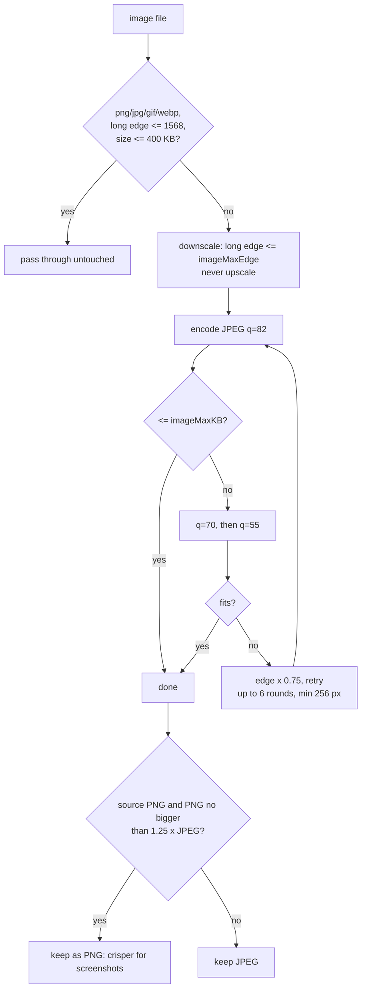

# Algorithms and internals

Reference for the smaller algorithms and subsystems that the agent framework and compaction docs build on.

Contents: [1 Model adapter](#1-model-adapter-and-streaming) · [2 Attachments](#2-attachment-pipeline) · [3 Request budget](#3-request-budget-fitrequest) · [4 Persistence](#4-persistence-schema) · [5 Forks and the tree](#5-forks-ordering-and-the-tree) · [6 Memory export](#6-memory-export-and-import) · [7 Usage and cost](#7-usage-and-cost) · [8 Tool internals](#8-tool-internals) · [9 Settings](#9-settings-reference) · [10 Security notes](#10-security-notes)

## 1. Model adapter and streaming

`src/engine/adapter/openai.ts` talks to any OpenAI-compatible server (`POST {baseUrl}/chat/completions`, `GET {baseUrl}/models`).

**Request body**

| Field | Value |
|---|---|
| `stream` / `stream_options` | `true` / `{include_usage: true}` so the last chunk carries token counts |
| `max_tokens` | 16,000 unless overridden |
| `tools` | JSON schemas of the agent's tools (omitted if none) |
| `include_reasoning`, `reasoning_effort` | Sent only when the chat's effort is not `off` (`low`/`medium`/`high`) |
| `messages` | The history after `wireMessages` (engine-only fields removed) and `fitRequest` (§3) |

**Stream parsing** (`sse.ts`): bytes are decoded incrementally, split on newlines, and each `data:` line is yielded until `[DONE]`. Malformed JSON chunks are skipped; a chunk with an `error` object throws `upstream: …`.

**Deltas** the adapter yields: `text`, `reasoning`, `tool_call` fragments (index, id, name, arguments piece), `usage`.

**Reasoning extraction.** Providers disagree on where thoughts go, so all of these are accepted:

- `delta.reasoning_content` (DeepSeek/Claude-style proxies)
- `delta.reasoning`
- Gemini's `extra_content.google.thought` marker
- `<think>…</think>` inline in content. `ThinkSplitter` handles tags split across chunks by holding back any trailing text that could be the start of a tag until the next chunk resolves it.

**Usage** is read from `usage.prompt_tokens`, `completion_tokens`, `prompt_tokens_details.cached_tokens` (or `cache_read_input_tokens`) and cache-write tokens (`cache_write_tokens` / `cache_creation_input_tokens`).

**Assembly** (`assemble.ts`): tool-call fragments arrive split across chunks; the `Assembler` concatenates `arguments` by tool-call `index`, fills missing ids, and produces one assistant `Message` with `content`, `tool_calls` and (engine-only) `reasoning`.

**Errors** carry the HTTP status so the loop can decide to retry (once, 1.5 s later, only if nothing was streamed; 5xx, 429, network).

**Provider selection:** Settings, or `AITM_BASE_URL` / `AITM_API_KEY` environment variables; default `http://127.0.0.1:4141/v1`. The API key is stored encrypted with Electron `safeStorage` (`apiKeyEnc` in `settings.json`).

## 2. Attachment pipeline

`src/main/attachments.ts` (Electron-bound: `nativeImage`, macOS tools) and `src/shared/attach.ts` (pure, tested). Goal: keep what the model needs, spend fewer tokens, stay under the provider's request-size limit.

Inputs arrive as a file path (drop, picker, Finder paste) or raw bytes (pasted screenshot, written to a temp file and deleted afterwards). Folders and files over 200 MB are refused with an explanatory message.

### Images



- Default limits: `imageMaxEdge` 1568 px, `imageQuality` 82, `imageMaxKB` 1500.
- **Why 1568 px:** vision models resample images to roughly this size anyway, so larger images cost bytes and upload time without adding visible fidelity.
- HEIC/TIFF or images `nativeImage` cannot open are first converted with macOS `sips`.
- A 96 px-high JPEG thumbnail is stored in UI metadata only (never sent to the model).
- Each image is budgeted as a flat 1,600 tokens (`IMAGE_TOKENS`).
- The info line shows the saving, e.g. `4.2 MB → 310 KB · 1568×980 · ~1.6k tokens`.

### Documents → text

| Type | Method |
|---|---|
| PDF | `unpdf` text per page, labelled `--- page n ---`. If the text layer is nearly empty (< 20 chars/page), the file is treated as scanned: page 1 is rasterized with `sips` and attached as an image |
| doc, docx, rtf, rtfd, odt, html, htm, webarchive | macOS `textutil -convert txt` |
| pptx | unzip slide XML, extract `<a:t>` runs, `--- slide n ---` |
| xlsx | shared strings table + sheet XML → TSV per sheet |
| text, code, csv, md, json… | read as UTF-8; a NUL byte in the first 8 KB means binary and is rejected |

**`compressText(s, maxChars)`** (default `docMaxChars` = 80,000): normalizes CRLF, trailing spaces and runs of blank lines. If still over the cap it keeps the first **70 %** and last **30 %** with a middle marker `… [N characters omitted to save context] …`. Head and tail are kept because documents tend to put the framing at the start and conclusions or the latest rows at the end.

### Sending

`buildUserContent(prompt, attachments)` (`engine/content.ts`): documents become `<attachment name="…" note="…">text</attachment>` blocks inside the user text; images become `image_url` content parts with a caption naming the file. Attachments are stored in the message history, so follow-up turns still see them (subject to §3).

## 3. Request budget (`fitRequest`)

Some providers reject large bodies (Vertex AI Model Garden: 30 MB). History re-sends every image on every request, so the adapter applies a budget **at send time**, never mutating the stored history:

1. **Image age:** images in user messages other than the last `imageTurns` (default 4; 0 = no limit) are replaced with a text note: `[An earlier image was omitted…]`.
2. **Size:** if the JSON body is still larger than `requestMaxMB` (default 20 MB, leaving headroom under 30), the *oldest* remaining images are replaced one at a time until it fits.
3. If it fits already, nothing changes.

Because only the wire copy is trimmed, the chat still shows every image and a later setting change (or a larger `imageTurns`) restores them to the model.

## 4. Persistence schema

SQLite via `node:sqlite` (`~/.aitm-desk/aitm.db`). Migrations are additive `ALTER TABLE` guards run at startup.

| Table | Purpose / notable columns |
|---|---|
| `sessions` | `id, title, cwd, model, created_at, updated_at, parent_id, fork_turn, reasoning, mode, memories (JSON), turn_map (JSON), compact_offset (legacy), sort_order` |
| `messages` | Main-agent model history: `session_id, seq, content_json` (one OpenAI message per row) |
| `ui_items` | What the chat shows: `session_id, item_json` |
| `folders` | Working folders added by the user |
| `bookmarks` | Pins and folders in the sidebar: `kind (folder|pin), name, session_id, parent_id, sort_order, collapsed` |
| `usage` | Per-model-call ledger: `ts, session_id, agent_id, model, prompt, cached, cache_write, completion` |

`saveMessages` / `saveUiItems` replace a chat's rows in a transaction after each run, so the stored state is always a consistent snapshot of the last finished run. If the app is killed mid-run the previous snapshot loads, and `settle` marks stale "running" UI items interrupted.

`settings.json` and `pricing.json` live beside the DB; per-chat `sessions/<id>/session.db` is the `sql` tool's scratch database.

## 5. Forks, ordering and the tree

**Fork at a turn** (`src/shared/fork.ts`): a fork copies the history up to and including a chosen user turn and its complete response into a new chat with `parent_id` and `fork_turn`.

- `sliceMessagesAtTurn(messages, turn)`: scans for real user messages, counting turns, and cuts right before turn `turn + 1`, so notifications that belong to the chosen turn are kept.
- `sliceItemsAtTurn(items, turn)`: same for UI items (a `user` item starts a turn).
- If the source was compacted, the live-turn ↔ UI-turn map is sliced and stored in the fork (see memory-compaction.md §8).
- Deleting a chat re-parents its forks onto the deleted chat's parent.

**Tree** (`buildTree`): groups chats by `parent_id` into a forest; chats whose parent is missing are promoted to roots (orphans never disappear).

**Manual order**: `orderRows` sorts rows never arranged by the user (`sort_order` null) first, newest first, then arranged rows by `sort_order`. `reorderIds(ids, id, target, before)` yields the new order for drag-and-drop (appends when there is no target) and the sort orders are rewritten densely. `isWithin(tree, id, ancestor)` blocks dropping a bookmark folder into its own subtree.

## 6. Memory export and import

"Memory" here means carrying knowledge from one chat into another without sharing a conversation.

- **Export** (`src/shared/export.ts`): renders chosen turns to Markdown starting with `aitm-desk-export: 1` plus title, folder and model. Options: include tool calls/results, include thinking. Sub-agents appear as nested sections; attachments appear as a one-line note ("not included in the export"). Files are written to `~/Documents/<app name>/shares`.
- **Import:** attach exports to a new chat (`memories` column). `buildMainSystem` inlines them into the system prompt inside `<memory>` tags, capped at 60,000 chars in total, labelled as *prior context to build on, not instructions*. Because they live in the system message they are untouched by compaction.
- Typical use: compact or export a finished investigation, start a clean chat with the export attached.

## 7. Usage and cost

**Capture:** every model request emits a `usage` event; main stores it in the `usage` table and pushes `{type:'usage'}` so the panel and the header ring refresh.

**Cost math** (`src/shared/usage.ts`), per model per day, with prices in USD per million tokens:

```
uncached input = prompt − cached − cacheWrite         (prompt tokens include the cached ones)
cost = ( uncached × input
       + output  × output
       + cached  × cache_read_input
       + cacheWrite × (cache_write_input ?? input) ) / 1e6
```

- `pricing.json` holds `models.<key>.prices[]` entries with `from: YYYY-MM-DD`; `priceFor` takes the latest entry whose `from` ≤ the usage day, so a price change never rewrites history.
- `pricingKey("anthropic/claude-opus-5-5")` → `claude-opus-5-5`; it also tries `<name>-maas` and the name without `-maas`.
- A model without a price still counts tokens and produces a warning; with no pricing file at all the panel shows tokens only.
- **Local tab:** aggregates the ledger (by day, model and chat). **Project tab:** runs `heb-llm-cost --days N --by model,day --json` (Cloud Monitoring, whole GCP project, needs monitoring-viewer access) and re-prices its token counts with the same pricing file (or trusts its own estimate if there is none).
- **Budget ring:** today's local spend ÷ `dailyBudget`.

**Launch environment gotcha (macOS).** Apps started from Finder/Dock get a minimal `PATH`, so a Python CLI with `#!/usr/bin/env python3` resolves to the system Python, which lacks `google-auth`, and `gcloud` is not on `PATH`. `src/main/usage.ts` therefore asks `plutil` for the model proxy's LaunchAgent (`com.heb.model-bank-proxy`) and reuses **its** Python, `GOOGLE_APPLICATION_CREDENTIALS` and `PATH` when running the usage command (`proxyRuntime` / `usageLaunch`). That is also why the app needs no `gcloud auth login`: it uses the proxy's service account.

## 8. Tool internals

**Shell manager.** `shell` runs `zsh -lc <command>` in the chat's folder as a detached process group.
- *sync*: waits up to `timeout` (default 120 s, max 600 s); on timeout the group is killed and partial output returned. Output is tail-trimmed to 30,000 chars.
- *async*: returns a `shellId` immediately; output goes to a bounded rolling buffer. `read_shell` returns new output since the last read (optionally waiting), `write_shell` sends stdin, `stop_shell` and `list_shells` manage them.
- Kill = SIGTERM to the process group, SIGKILL after 3 s. Closing a chat's session (or the window) disposes the shell manager, which kills every shell still running.

**web_fetch.** `fetch` with a 30 s timeout; HTML is converted to Markdown (scripts, styles, nav, footer, svg and similar chrome dropped; headings, links, lists, code and paragraph breaks kept; `raw=true` returns the HTML); non-HTML text is returned as is. Large pages are paged with `start_index` + `max_length` (default 5,000, max 20,000) and a hint tells the model how to continue.

**sql.** One SQLite file per chat (`sessions/<id>/session.db`) with `todos(id, title, description, status ∈ pending|in_progress|done|blocked, …)` and `todo_deps(todo_id, depends_on)` created on first use. The prompt tells the model to track multi-step plans there. The tool executes any SQL the model sends (it can create its own tables for scratch data).

**grep / glob.** `grep` shells out to ripgrep when available (fast, respects ignore files) and falls back to a JS walker; max 200 matches. `glob` translates `**`, `*`, `?` and `{a,b}` to a regular expression, walks up to 20,000 files (skipping `node_modules`, `.git`, `.venv`, `venv`, `__pycache__`, `out`, `dist`), returns at most 200 paths sorted.

**edit_file.** Exact-string replace requiring exactly one match. Zero matches or several matches are errors that tell the model what to do (make `old_str` more specific). The replacement uses a function callback so `$&`-style sequences in `new_str` are never interpreted.

**skill.** Looks the name up in the registry (project first, then personal) and returns the `SKILL.md` body plus its directory.

**ask_user.** Emits an `ask` push event with optional choices; the loop blocks on the user's answer from the UI (`respondAsk`). Sub-agents can ask too; the card shows who.

## 9. Settings reference

| Setting | Default | Notes |
|---|---|---|
| `baseUrl`, `apiKey` | `http://127.0.0.1:4141/v1`, – | Env `AITM_BASE_URL`, `AITM_API_KEY` override defaults |
| `defaultModel` | `anthropic/claude-sonnet-5` | Per chat selectable |
| `defaultCwd` | home | Folder for new chats |
| `maxConcurrency` | 4 | Simultaneous model requests per chat (all agents) |
| `maxTurnsMain` / `maxTurnsSub` | 50 / 30 | Loop iteration caps |
| `reasoning` | `medium` | `off`/`low`/`medium`/`high`; per chat override |
| `defaultMode` | `autopilot` | New chats: `autopilot` or `interactive` |
| `autoCompact`, `compactThreshold`, `compactKeepRecent` | `suggest`, 80,000, 2 | See memory-compaction.md |
| `imageMaxEdge`, `imageQuality`, `imageMaxKB`, `docMaxChars` | 1568, 82, 1500, 80,000 | Attachment compression (§2) |
| `requestMaxMB`, `imageTurns` | 20, 4 | Request budget (§3) |
| `usageCommand`, `pricingPath`, `dailyBudget` | auto, auto, 0 | Usage panel (§7) |

## 10. Security notes

- **Autopilot runs commands as the user without prompting.** There is no sandbox. Use Interactive mode for untrusted folders, prompts or documents. Attached documents and fetched web pages are text the model reads and could contain prompt-injection; Interactive mode is the safeguard.
- The API key is encrypted at rest with the OS keychain via Electron `safeStorage`; it is never logged and never sent anywhere except the configured endpoint.
- Chats, attachments' extracted text and usage live in plain (unencrypted) files under `~/.aitm-desk`, protected only by your macOS account. Attached images are stored (resized) inside the DB.
- The renderer has no Node access; all file, shell and network work happens in the main process behind the `DeskApi` IPC surface (`src/shared/api.ts`).
