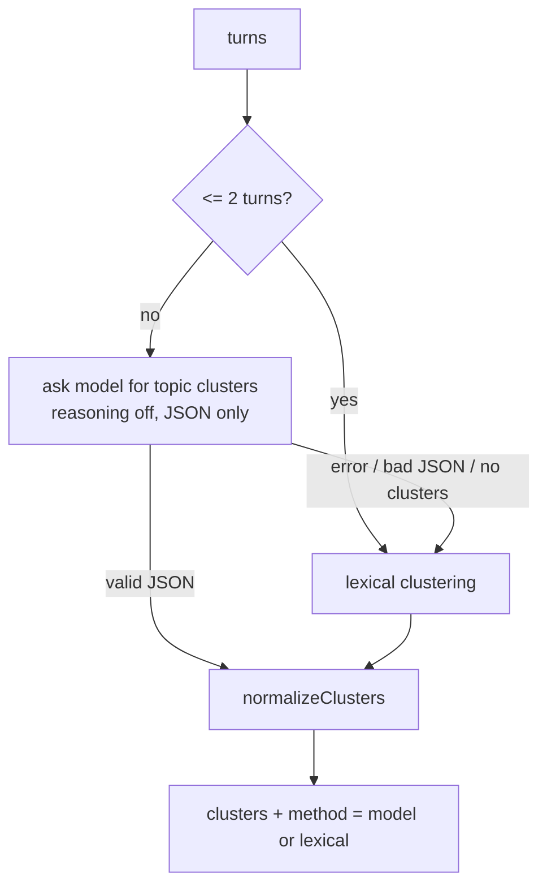
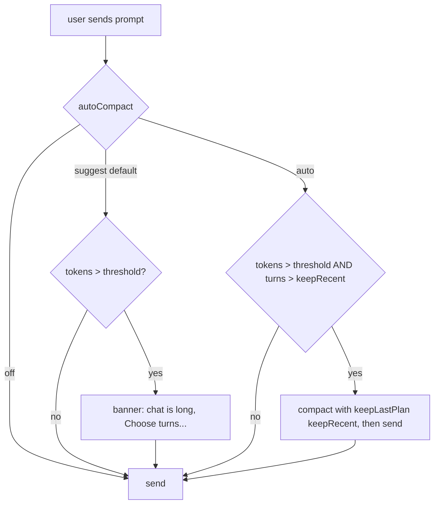

# Memory compaction

Long chats outgrow the model's context window and get slower and more expensive on every request (the whole history is re-sent each time). Compaction replaces old history with a compact summary **plus** the turns you choose to keep verbatim, so the agent keeps the important facts without carrying every message.

Source: `src/engine/compact.ts` (algorithms), `Session.compact` in `engine.ts`, orchestration in `src/main/index.ts` (`compactSession`, auto-compact in `run`), UI in `CompactModal.tsx`, turn mapping in `src/shared/fork.ts`.

## 1. Design goals

1. **Never silently lose something the user cares about.** The user can see exactly which turns will be kept, summarized and dropped before anything happens.
2. **Keep recent work exact.** Recent turns stay verbatim, including their tool calls and results, so the agent can continue mid-task.
3. **Compaction must be repeatable.** Compacting a compacted chat merges the old summary into the new one instead of summarizing a summary of a summary.
4. **Survive failures.** If clustering or the model fails, the feature degrades (keyword clustering) rather than breaks. History is replaced only after a summary has been produced.
5. **Keep the UI and the forks consistent** even though the model-facing history no longer matches what the user scrolls through.

## 2. Vocabulary

| Term | Meaning |
|---|---|
| **Turn** | A "real" user message plus everything up to the next real user message: assistant messages, tool calls, tool results, notifications. The atomic unit of compaction. |
| **Real user message** | A user message that is not a `<system_notification>` (background-agent notice) and not the `<compacted_history>` summary message. This keeps one user prompt and all the agent work it triggered together, and stops injected messages from creating bogus turns. |
| **Plan** | `{ keep: number[], summarize: number[] }` of turn indexes. |
| **Live history** | The model-facing `messages[]` (after the system prompt). |
| **UI turn** | A turn as shown in the chat. After compaction, live turns map onto UI turns through the turn map (§8). |

## 3. The plan: keep, summarize, drop

Every turn is in exactly one bucket:

| Bucket | Result |
|---|---|
| **keep** | Stays verbatim in the history. |
| **summarize** | Read by the summarizer; its content survives only as part of the summary. |
| **drop** (in neither list) | Removed completely, not summarized. |

If a turn is in both lists, **keep wins** (`planTurns`). Two ways to build a plan in the UI:

- **Keep the last N** (`keepLastPlan(n, k)`): keep the last `k` turns, summarize everything before. This is the default and what auto-compaction uses.
- **Choose turns:** per-turn Keep / Summarize / Drop, with topic **clusters** to speed it up (§5). "Choose" mode starts from whatever "keep last N" currently means so switching modes never changes the selection unexpectedly.

If nothing would be summarized or dropped, nothing happens.

## 4. Token estimation

Used for the "this chat is long" banner, the auto-compact trigger and the before/after numbers.

```
tokens ≈ JSON.stringify(message).length / 4        (per message, summed)
image content part  = 1600 tokens flat             (IMAGE_TOKENS)
```

Chars/4 is a deliberately cheap, tokenizer-free approximation that is good enough for threshold decisions. Images are counted flat instead of by their base64 size, which would overstate them by orders of magnitude (provider vision costs depend on resolution, not on base64 bytes).

## 5. Clustering related turns (`clusterTurns`)

Purpose: in long chats the topic often pivots and returns ("data question → UI fix → back to the data question"). Selecting by *topic* is more natural than by position, so the picker recommends groups of related turns.



**Model clustering.** The model receives a digest of each turn: `[n] USER: <400 chars> / ASSISTANT: <400 chars of the final answer> / TOOLS: names`. It is asked to group turns by topic, allowing non-adjacent turns, every turn in exactly one cluster, with a 2–5 word label and a one-line reason, and to reply with JSON only. The JSON object is extracted from the first `{` to the last `}` so stray prose or code fences do not break parsing.

**Lexical fallback** (deterministic, no model call):

1. Each turn becomes a keyword set from `user + user + answer` (the user text is counted twice so the question outweighs boilerplate in the answer). Keywords are lowercase tokens of ≥3 chars matching `[a-z][a-z0-9_-]`, stop words removed.
2. Single-link clustering with union-find: two turns are merged when the **Jaccard similarity** of their keyword sets is ≥ 0.12 (`|A∩B| / |A∪B|`). Single-link means similarity chains: A~B and B~C puts A, B, C together even if A and C share little.
3. A cluster's label is its three most frequent keywords.

**`normalizeClusters`** makes the output safe whichever path produced it: drops indexes that do not exist, keeps only the first occurrence of duplicates, adds every missed turn as a singleton cluster, and sorts clusters by first turn. The UI can therefore rely on every turn appearing exactly once. The method (`model` or `lexical`) is shown to the user ("Related turns (AI)" vs "(keywords)").

Clusters are advisory: the user can still change each turn individually.

## 6. Summarization (`summarizeTurns`)

Only the **summarize** bucket is sent to the model, as a transcript with per-field clipping so one huge tool result cannot dominate:

| Field | Clip |
|---|---|
| User message | 8,000 chars |
| Assistant text | 6,000 chars |
| Tool-call arguments | 600 chars |
| Tool result | 1,500 chars |
| Notifications | 800 chars |

Clipped text ends with `…`. The transcript is labelled `### Turn n`, `USER:`, `ASSISTANT:`, `TOOL CALL name:`, `TOOL RESULT:`, `NOTIFICATION:`.

**What the summarizer is told to retain** (the system prompt frames it as "working memory for an AI agent that will continue the conversation"):

- the user's goals and preferences
- key facts and numbers
- decisions **and their reasons**
- files, paths and commands that matter
- results of tool runs
- open questions and next steps

and to *group by topic*, omit pleasantries and dead ends unless they explain a decision, and "be concise but lose nothing important". Output is dense Markdown.

An empty summary throws, so a failed call can never wipe the history.

**Why these choices.** Tool results are large and mostly noisy, but they carry the *evidence* for decisions, so they are clipped, not removed. User messages get the largest budget because they hold the intent. Tool-call arguments are kept short because the intent is visible in the assistant text and the result.

### Incremental merge (summary of a summary)

If the history already starts with a `<compacted_history>` message, `priorSummary()` extracts it and the prompt prepends:

```
Existing summary of even earlier history (merge it in):
<previous summary>
```

The model produces **one** merged summary, so earlier memory is carried forward and repeated compaction does not stack nested summaries. Because the new summary is rewritten each time, details that were already thin can fade over many compactions; the user's *kept* turns and the `compact` marker in the UI keep the audit trail.

## 7. Building the new history (`applyCompaction`, pure)

```
before:  [turn0][turn1][turn2][turn3][turn4]            plan: keep [3,4], summarize [0,1], drop [2]
summary = summarize(turn0, turn1, merge(prior summary))
after:   user:  <compacted_history> Summary of the earlier conversation ... </compacted_history>
         assistant: "Understood. I have the summary of the earlier conversation and will build on it."
         [turn3][turn4]                                  (verbatim, original order)
```

- The summary is a **user** message followed by a fixed assistant acknowledgement so the conversation alternates correctly for every provider, and so the model treats the summary as shared context rather than as an instruction.
- The system prompt (index 0) is untouched; `Session.compact` splices the new history in after it.
- Kept turns are copied unchanged, so tool-call / tool-result pairs inside them remain valid.
- Kept turns need not be contiguous (e.g. keep turns 1 and 4, summarize 2–3).
- If the summary is empty (everything kept or dropped) no summary message is added.
- Compaction is refused while the chat is busy (`session is busy`).

## 8. The turn map: keeping the UI and forks consistent

After compaction the live history has fewer turns than the chat shows. `sessions.turn_map` (a JSON array) records, for each live turn, the UI turn number it came from:

```
UI turns:   0 1 2 3 4 5 6           compact keep [1, 5, 6]
turn_map:   [1, 5, 6]               live turn 0 = UI turn 1, live 1 = UI turn 5, ...
new turn:   liveTurnMap extends     → [1, 5, 6, 7, 8, ...]
```

`liveTurnMap(count, map, offset)` extends the stored map for turns added after the compaction (consecutive numbering from the last mapped value). An older `compact_offset` form (all turns before an offset were removed) is still understood.

It is used for:

- **Forking** a chat at a UI turn: the fork keeps the live turns whose UI number is ≤ the chosen turn (`map.filter(u => u <= turn)`), copies the summary (it is part of the live history) and gets an adjusted map.
- **UI markers**: after compaction the `compact` item inserted into the thread records the kept, summarized and dropped UI turn numbers (`keptTurns`, `summarizedTurns`, `droppedTurns`), a before/after token count and the summary text, so users can read what the agent now "remembers".

The user-visible transcript (`ui_items`) is never rewritten, only annotated: you can still scroll through the old conversation, but the model no longer sees it.

## 9. When compaction runs



| Setting | Default | Meaning |
|---|---|---|
| `autoCompact` | `suggest` | `off`, `suggest` (banner only) or `auto` |
| `compactThreshold` | 80,000 tokens | Estimated size that triggers the banner / auto-compaction |
| `compactKeepRecent` | 2 | Turns kept verbatim by auto-compaction |

Auto-compaction runs *before* the new prompt is sent and uses the simple keep-last-N plan (no clustering call) so it adds only one model call. If it fails (e.g. the endpoint is down) an `Auto-compact failed: …` error is shown, the history is left untouched (it is only replaced after a summary exists) and the prompt is still sent. Manual compaction goes through the dialog: choose mode, review the buckets, see the before/after estimate, confirm.

## 10. What is kept and what is lost

| Kept exactly | Kept approximately | Lost |
|---|---|---|
| Turns in **keep** (messages, tool calls and results) | Content of **summarize** turns, as written by the model | Content of **drop** turns |
| System prompt, skills list, attached memories (they are in the system message, outside the history) | Earlier summaries (merged, can fade over many rounds) | Raw tool output beyond the clip limits in summarized turns |
| The full UI transcript | | Attachments (images/documents) inside summarized or dropped turns, other than what the summary says about them |

Practical advice: keep the turns that contain the *current task state* (files being edited, a half-finished plan), and let finished side topics be summarized.

## 11. Trade-offs and known limits

- **Summaries are lossy and model-written.** A summarizer can omit a detail or state one with false confidence. Mitigation: the prompt asks for decisions with reasons and specifics (paths, numbers, commands), the summary is shown to the user, and verbatim keep is always available.
- **chars/4 is approximate.** It can be off by ±30% (code and non-English text tokenize denser). Thresholds are therefore conservative defaults, not precise limits.
- **Cost:** one model call (plus one optional clustering call). The summarize call is bounded by the clipping limits, so cost scales with the number of turns summarized, not their raw size.
- **Single-link lexical clustering** can chain unrelated turns through a common word; that is why clusters are advisory and shown with labels.
- **No semantic search over dropped content.** Dropped turns are gone from the model's view; only exports (see algorithms-and-internals.md) preserve them outside the chat.
- **Sub-agent transcripts** are never in the live history (only their final result inside the parent's `task` tool result), so they add nothing to compact.

## 12. Tests

`tests/compact.test.ts` covers turn splitting (notifications and summary messages do not start turns), plan semantics (keep wins), normalization (duplicates, unknown indexes, leftovers), lexical clustering, incremental merge via `priorSummary`, `applyCompaction` ordering, and `Session.compact` with non-contiguous keep/summarize/drop sets. `tests/fork.test.ts` covers fork slicing, the live turn map and ordering helpers.
