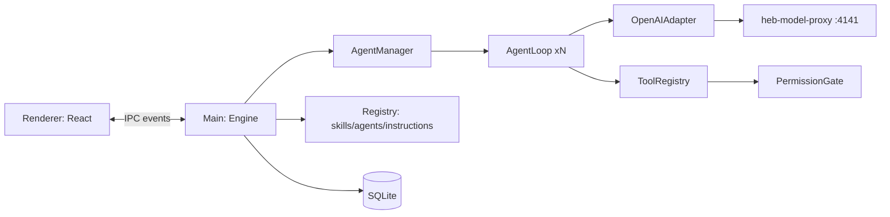

# AITM Desk — Design Spec

**Date:** 2026-11-13 · **Status:** Draft for review

## 1. Goal
A lightweight macOS desktop app, styled like the GitHub Copilot app, for running an
agent (with sub-agents) against custom models served by the local
`heb-model-proxy`. No repo/git/PR features. It loads skills, agents, and
instructions the same way Copilot does, from the working folder's `.github/` and
from `~/.copilot/`.

## 2. Non-goals (MVP)
Git, worktrees, PRs, MCP servers, context compaction, image attachments,
cloud sync, auto-update, multi-window.

## 3. Constraints and verified facts
- Model backend: `heb-model-proxy` at `http://127.0.0.1:4141/v1` (OpenAI-compatible).
  `GET /v1/models` returns 11 models. `POST /v1/chat/completions` serves all of them.
  The proxy translates Claude models to the Anthropic API on the server side, so
  the app needs **one OpenAI-compatible adapter** to cover both dialects.
- Auth is a static bearer key (the proxy's API key), stored in settings.
- Reasoning models may emit `reasoning_content` and need a generous `max_tokens`.
- Skill format: `<dir>/SKILL.md` with YAML frontmatter (`name`, `description`, ...).
  The working folder has about 116 skills.
- Agent format: `*.agent.md` with YAML frontmatter (`name`, `description`, `tools`)
  and a markdown body that serves as the system prompt.

## 4. Stack
Electron, TypeScript, React (renderer), and better-sqlite3. The agent engine runs
in the Electron **main process** as a headless module with no UI imports, so the
CLI can drive the same engine.

## 5. Architecture

### 5.1 Units
| Unit | Purpose | Interface (summary) | Depends on |
|---|---|---|---|
| `adapter/openai.ts` | Streaming chat completions with tool calls | `stream(req, signal): AsyncIterable<Delta>` (text, reasoning, tool_call fragments, usage, finish) | fetch |
| `adapter/assemble.ts` | Assembles streamed tool-call fragments into complete calls | `assemble(deltas) -> AssistantMessage` | — |
| `registry/skills.ts` | Discovers and parses skills | `listSkills(cwd) -> SkillMeta[]`, `loadSkill(name) -> {body, dir}` | fs, yaml |
| `registry/agents.ts` | Discovers and parses agents | `listAgents(cwd) -> AgentDef[]` | fs, yaml |
| `registry/instructions.ts` | Collects instruction files | `loadInstructions(cwd) -> string` | fs |
| `engine/prompt.ts` | Builds the system prompt | `buildSystem(ctx) -> string` | registry |
| `engine/loop.ts` | Runs one agent conversation | `run(agentDef, messages, signal) -> events + final text` | adapter, tools |
| `engine/manager.ts` | Tracks the agent tree, concurrency, and background agents | `spawn(opts) -> agentId`, `read(id, wait)`, `cancel(id)` | loop |
| `engine/tools/*.ts` | One file per tool, each exporting `{schema, run(args, ctx)}` | see §6 | permissions |
| `engine/permissions.ts` | Approval gate | `request(kind, detail) -> allow/deny` | IPC bridge |
| `store/db.ts` | Persists sessions, messages, and agent runs | CRUD | better-sqlite3 |
| `renderer/*` | UI (§8) | IPC | — |
| `cli/index.ts` | Headless runner for tests | `aitm-desk -p "..." --model X --cwd D` | engine |

### 5.2 Registry rules
- Search order (first match wins by `name`): `<cwd>/.github/skills/*/SKILL.md`,
  then `~/.copilot/skills/*/SKILL.md`. Agents use the same order:
  `<cwd>/.github/agents/*.agent.md`, then `~/.copilot/agents/*.agent.md`.
- Instructions are concatenated in this order: `~/.copilot/copilot-instructions.md`,
  then `<cwd>/.github/copilot-instructions.md`.
- Malformed frontmatter skips that file and records a warning in Settings →
  Diagnostics. It never crashes startup.
- The registry is rescanned whenever a new session starts. No file watching in the MVP.

### 5.3 Loading skills on demand
The system prompt lists each skill as `name: description` only. The `skill(name)`
tool returns the full `SKILL.md` body plus its directory path, so the model can
reference `assets/` files with relative paths through `read_file` and `shell`.

## 6. Tools
| Tool | Behavior | Needs approval |
|---|---|---|
| `shell` | Runs `/bin/zsh -lc <cmd>` in the session cwd. Default timeout 120 s, max 600 s. stdout and stderr are capped at 30 KB (the tail is kept). Returns the exit code | yes |
| `read_file` | Reads a file, optionally a line range. Output capped at 50 KB | no |
| `write_file` | Creates or overwrites a file | yes |
| `edit_file` | Replaces an exact string. Fails if the match is not unique | yes |
| `glob` | Matches files by pattern under cwd | no |
| `grep` | Regex search via ripgrep if present, otherwise a JS fallback | no |
| `skill` | Loads a skill body (§5.3) | no |
| `task` | Spawns a sub-agent (§7). Args: `agent?`, `prompt`, `mode: "sync"\|"background"` | no |
| `read_agent` | Gets a sub-agent's status or result. Args: `id`, `wait?: bool`, `timeout?: s` | no |
| `list_agents` | Lists sub-agents in this session and their statuses | no |
| `ask_user` | Asks the user a question, optionally with choices | no |

Running generated code is `write_file` followed by `shell` (for example
`python x.py`). It uses the venv or `PYTHON_PATH` from the cwd `.env` if the
skill's scripts call for it. The app does not inject `.env` itself; skills load
their own.

## 7. Agents and sub-agents
- **Main agent:** a default system prompt plus instructions, the skill list, and
  the agent list. It has all tools.
- **Sub-agent:** `task` creates a new `AgentLoop` with fresh messages: the agent's
  `.agent.md` body (or a generic prompt) plus the prompt it was given. Tools are
  limited by the agent's `tools:` frontmatter, mapped as `read→read_file,glob,grep`,
  `edit→write_file,edit_file`, `execute→shell`, `search→glob,grep`. If no list is
  given, it gets all tools. A sub-agent gets `task`, `read_agent`, and `list_agents`
  only up to a **max depth of 2**.
- **Sync mode:** the parent's tool call waits and receives the sub-agent's final
  text.
- **Parallel:** when one assistant message contains several tool calls, the loop
  runs them **concurrently** (`Promise.all`). Several `task` calls in one turn are
  how parallel sub-agents happen.
- **Background mode:** `task` returns `{agentId}` immediately. The sub-agent keeps
  running. The parent gets results via `read_agent(id, wait)`. When a background
  agent finishes, the manager injects a short system notification into the
  parent's next turn.
- **Concurrency:** a global semaphore allows at most 4 model requests at once
  (configurable). Extra requests wait in a queue.
- **Cancellation:** Stop cancels the main loop and every descendant through
  `AbortController` trees. Running shell processes get SIGTERM, then SIGKILL after 3 s.
- **Statuses:** `running | completed | failed | cancelled`.

## 8. UI (Copilot-like, minimal)
- **Left sidebar:** new chat button, session list (title and date), and a settings
  gear at the bottom.
- **Center:** an empty state with a logo and a centered prompt box. In a
  conversation, messages are streamed markdown with code highlighting, and the
  prompt box is pinned to the bottom.
- **Prompt box footer:** model picker (filled from `/v1/models`), folder picker
  (cwd), send/stop button.
- **Tool cards:** collapsible, showing the tool name, a one-line summary, a status
  spinner or check, and expandable args and output.
- **Sub-agent cards:** nested and collapsible with a live status. Background
  agents also appear in a small "Agents" tray above the prompt box.
- **Approvals:** an inline card with Allow / Allow for session / Deny.
- **`ask_user`:** an inline card with choice buttons and a free-text field.
- **Settings:** base URL, API key (in macOS Keychain via `safeStorage`), default
  model, max concurrency, max turns, and Diagnostics (registry warnings, a proxy
  health check).

## 9. Data
SQLite at `~/Library/Application Support/AITM Desk/aitm.db`:
- `sessions(id, title, cwd, model, created_at, updated_at)`
- `messages(id, session_id, agent_id, role, content_json, created_at)`
- `agents(id, session_id, parent_id, name, mode, status, final_text, created_at, ended_at)`

The title is generated from the first user prompt (first 60 characters; no extra
model call in the MVP).

## 10. Error handling
- Proxy unreachable or 5xx: one retry with backoff, then an error bubble with a
  "Retry" button. A 401 points the user to Settings.
- Malformed tool-call JSON from the model: return a tool error message so the
  model can fix itself. Do not crash.
- Max turns (default 50 for main, 30 for sub-agents) reached: stop and report.
- Tool exceptions are always returned to the model as `{error}` text.
- A sub-agent failure is returned to the parent as text: `failed: <reason>`.

## 11. Testing
- Unit (vitest): registry parsing (fixtures with good and bad frontmatter),
  assembly of streamed tool-call fragments, tool-name mapping, `edit_file`
  uniqueness, shell timeout and truncation, manager concurrency and cancellation
  (using a fake adapter).
- Engine integration: a scripted fake adapter that drives parallel and background
  sub-agent flows end to end.
- Live smoke test (manual or opt-in): the CLI runs against the proxy with one
  OpenAI-dialect model and one Claude model, and with a prompt that loads a real
  skill from `.github/skills`.

## 12. MVP milestones
1. Headless engine: adapter, loop, core tools, registry, CLI. Passes live smoke tests.
2. Sub-agents: sync, parallel, background, read_agent, cancellation.
3. Electron shell: chat UI, streaming, tool cards, approvals, settings.
4. Persistence and session sidebar.
